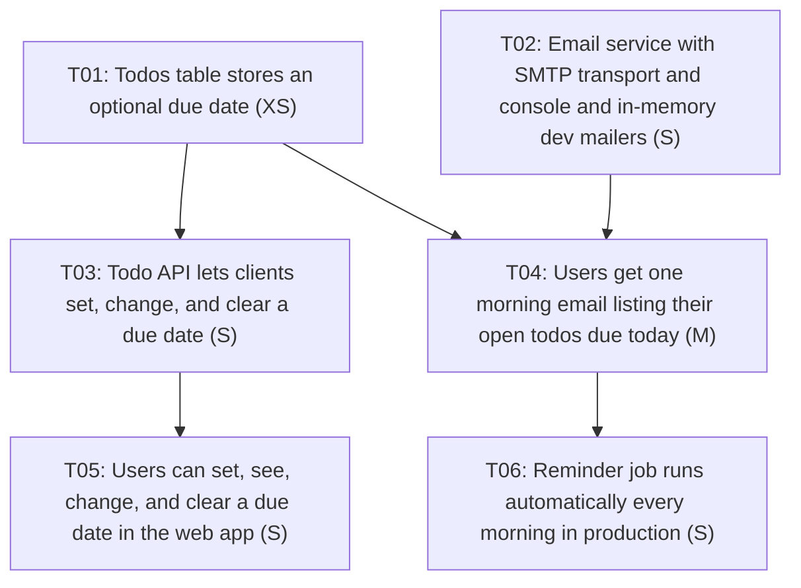

## Goal

Users can give a todo an optional due date, set and changed from the API and the web UI. Every morning,
anyone with open todos due that day gets one email listing them. We'll know it works when teammates with
something due get exactly one reminder that morning in production, and people with nothing due get no
email.

## Background

- **Request** (chat, 2026-11-06): "add due dates to todos + a reminder email in the morning for anything
  that's due that day." The team tracks work in GitHub Issues (`acme-example-org/todo-app` per
  `.claude/ticket-creator.yml`). These are **drafts only**; nothing has been pushed.
- **Stack** (`package.json`, todo-app 0.4.0): Express + better-sqlite3 + zod API in `src/`, vanilla JS
  frontend in `public/`, vitest + supertest API tests in `tests/`. Commands: `npm test`, `npm run lint`,
  `npm run dev`, `npm run db:migrate`. ESM project (`"type": "module"`, imports use `.js` suffixes).
- **Data**: `users(id, email, display_name)` and `todos(id, user_id, title, done, created_at)` in
  `src/db/migrations/001_create_users_todos.sql`. Migrations are numbered `.sql` files applied in order
  by `src/db/index.ts: migrate()`, which runs on every `openDb()`. There's no due date column today.
- **Users and email**: users are identified by the `X-User-Id` header from the internal auth proxy
  (`src/app.ts`). Every user already has an `email` in `users` (synced nightly from the directory), so
  reminders don't need to collect addresses. No per-user timezone is stored.
- **Missing infrastructure**: the app has no email sending, no scheduler or background jobs, and no
  config library. Env vars are read directly (`DB_PATH`, `PORT` in `src/server.ts`).
- **API shape**: responses are DB rows spread through `toTodo()` in `src/services/todoService.ts`, so
  field names are snake_case (`user_id`, `created_at`). The new field follows suit: `due_date`.
- **Pre-existing issues I noticed, not ticketed here**: `public/index.html` links `styles.css`, which
  isn't in `public/`. I didn't find a `tsconfig.json` or an ESLint config, though `npm run build` and
  `npm run lint` expect them. Check that those commands work on main before relying on them in review.

## Non-goals

- Due *times* or per-todo reminder times (dates only)
- Per-user timezones or per-user send times
- Opt-out or notification preference settings
- Reminders for overdue todos (due before today) or advance reminders ("due tomorrow")
- Overdue highlighting, sorting, or filtering by due date in the UI
- Other channels (Slack, push) and HTML email templates
- Recurring todos

## Assumptions & open questions

The user was unavailable during drafting and asked me to make reasonable calls, so every interview
question below was answered with the recommended default. Please review these before pushing.

1. **Slicing strategy** *(assumed)*: vertical slices + enablers. This is the usual fit for a product feature
   in an existing codebase. Two enablers are split out: the DB column (needed by the API, UI, and job)
   and the email service (a new dependency plus config, and it lets the job be tested with a fake).
2. **Due date granularity** *(assumed)*: date only, stored as `TEXT` `YYYY-MM-DD`, nullable. Past dates
   are allowed (no validation against "today").
3. **What "morning" and "today" mean** *(assumed)*: the job runs at 08:00. "Today" is evaluated in one
   team-wide IANA timezone, `REMINDER_TIMEZONE`, which defaults to the host's timezone so it agrees with
   the scheduler's clock. *(open)* Which timezone is the team in, and is anyone far enough away that a
   single send time would be a problem? Per-user timezones would need a new `users` column, and that
   table is synced nightly from the directory, so it'd need a decision on who owns that field.
4. **Email content** *(assumed)*: one plain-text digest per user per day listing all their *open*
   (`done = 0`) todos due that day. No email when nothing is due. Done todos are excluded. *(open)*
   Should overdue, still-open todos be included too? That would be a small follow-up to T04.
5. **Email delivery** *(assumed)*: SMTP via `nodemailer`, configured by `SMTP_URL` and `MAIL_FROM`.
   SMTP works with nearly every provider (SES, SendGrid, Postmark, or an internal relay). *(open)* Which
   provider or relay, and which from-address? This only blocks T06. T02 and T04 can be built and tested
   with the console and in-memory mailers.
6. **Scheduling** *(assumed)*: a standalone script (`npm run job:due-reminders`) triggered by the host's
   scheduler, not an in-process timer in `src/server.ts`. In-process timers miss runs across restarts
   and double-send with more than one instance. Sends are recorded per (user, date), so re-runs are
   safe. *(open)* Where does production run? Nothing in the repo shows it (no Dockerfile, CI, or process
   manager config). T06 starts by confirming this.
7. **No opt-out in v1** *(assumed)*: this is an internal tool with users from the directory, and the email
   only goes out on days something is due. *(open)* If you want an opt-out, it'd be one more S ticket
   blocked by T04 (a column on `users` or a new preferences table, plus a toggle in the UI).
8. **API field name** *(assumed)*: `due_date` in both requests and responses, matching the existing
   snake_case response fields.
9. **UI** *(assumed)*: a native `<input type="date">` on the add form and on each todo row, which both
   shows and edits the date. No overdue styling.
10. **Rollout** *(assumed)*: no feature flag. Due dates are additive and backwards compatible. Reminders
    stay off until T06 schedules the job in production.
11. **Priority** *(assumed)*: no deadline was given. T01 is high because it's on the critical path for
    three tickets. Everything else is medium.

## Existing work

Not checked; please search before pushing. The read-only search
`gh issue list -R acme-example-org/todo-app --search "due date" --state all` failed with "Could not
resolve to a Repository with the name 'acme-example-org/todo-app'". Either the repo name in
`.claude/ticket-creator.yml` is wrong, or the logged-in `gh` account can't see it. There were no other
local drafts under `tickets/`. Suggested searches once the repo is reachable: `due date`, `reminder`,
`email`, and `label:epic is:open` (to find an existing epic these could go under).

## Definition of done

- [ ] All tickets below are closed
- [ ] In production, a teammate with an open todo due today receives exactly one reminder email that
      morning, and teammates with nothing due receive none
- [ ] README documents the `due_date` API field, the mail env vars, and how the reminder job is
      scheduled and safely re-run
- [ ] The open questions above are answered, or moved into follow-up issues

## Plan

<!-- ticket-creator:generated:start v=3 sig=904a608da6f5 (rewritten by `tickets.py render`; edit the ticket files instead) -->

### Tickets

| ID | Ticket | Type | Size | Priority | Blocked by | Wave |
|---|---|---|---|---|---|---|
| T01 | Todos table stores an optional due date | enabler | XS | high | - | 1 |
| T02 | Email service with SMTP transport and console and in-memory dev mailers | enabler | S | medium | - | 1 |
| T03 | Todo API lets clients set, change, and clear a due date | feature | S | medium | T01 | 2 |
| T04 | Users get one morning email listing their open todos due today | feature | M | medium | T01, T02 | 2 |
| T05 | Users can set, see, change, and clear a due date in the web app | feature | S | medium | T03 | 3 |
| T06 | Reminder job runs automatically every morning in production | chore | S | medium | T04 | 3 |

**6 tickets** · 1 XS, 4 S, 1 M · about 3 dev-days of work for one developer (XS ≈ 1 h, S ≈ ½ day, M ≈ 1 day)

### Build order

- **Wave 1 - start here, in parallel:** T01, T02
- **Wave 2 - in parallel:** T03, T04
- **Wave 3 - in parallel:** T05, T06

### Dependency graph

<!-- ticket-creator:generated:end -->
